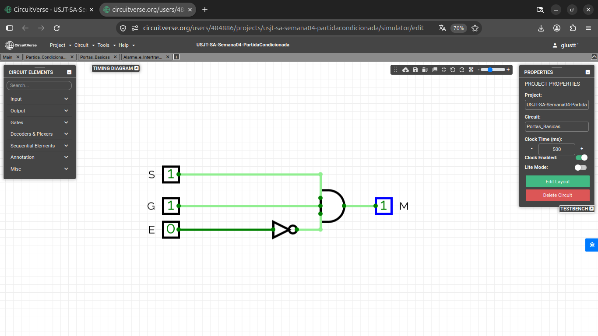
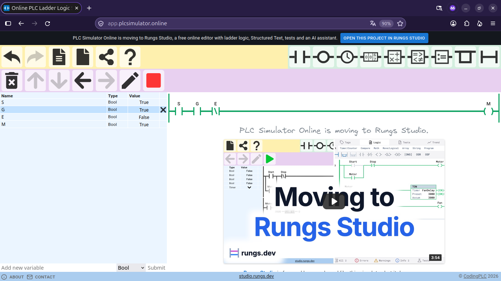
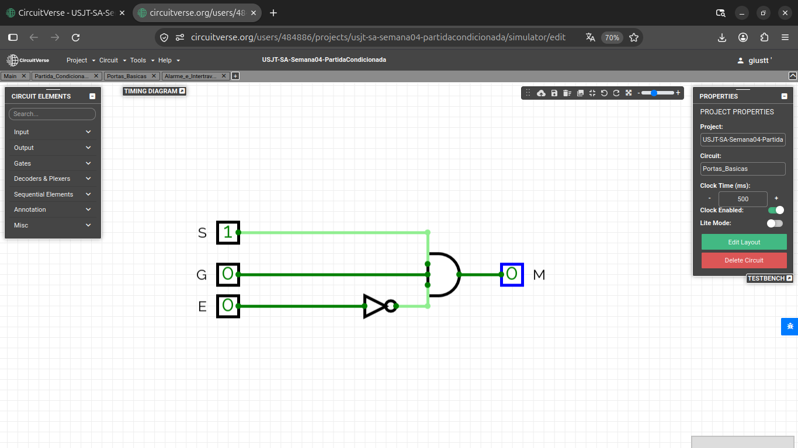
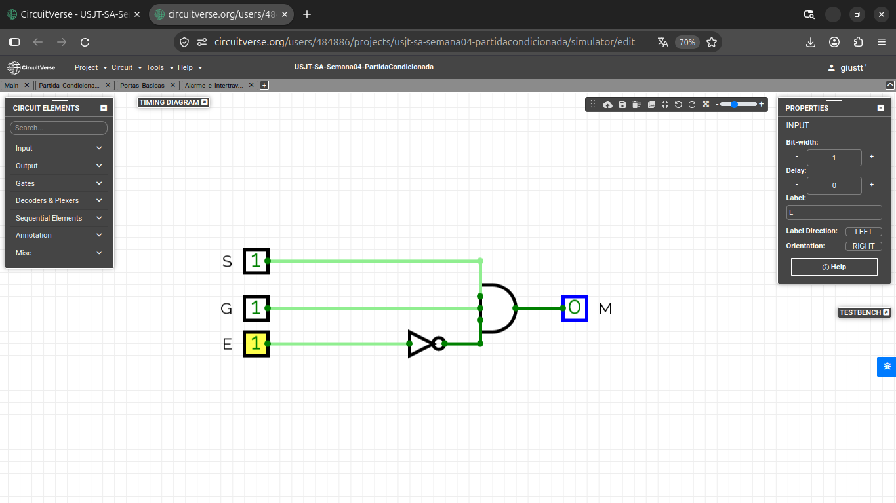
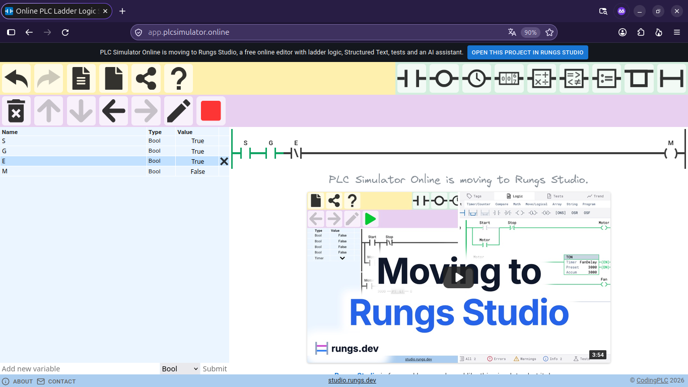

# UC Sistemas Automatizados — Semana 04: Sistemas Discretos e Lógica Combinacional

---

## 🔗 Links das Simulações Executáveis

* **Simulação em Portas Lógicas (CircuitVerse):** [Acessar Projeto no CircuitVerse](https://circuitverse.org/users/484886/projects/usjt-sa-semana04-partidacondicionada)
* **Simulação em Diagrama Ladder (PLC Simulator Online):** [Acessar Diagrama no PLC Simulator Online](https://app.plcsimulator.online/gNO3ylzsogvHUI5tmyzX)

---

## 1. Definição de Variáveis e Convenções Lógicas

Adota-se **lógica positiva** para todas as proposições de entrada e saída (o valor `1` indica que a condição declarada está presente/ativa, independentemente da configuração elétrica NA/NF do sensor físico em campo):

### 1.1. Variáveis do Exemplo Central (Partida Condicionada)
| Símbolo | Tag | Valor `0` (FALSE) | Valor `1` (TRUE) | Função Lógica |
| :---: | :--- | :--- | :--- | :--- |
| **`S`** | `START` | Botão de partida liberado | Botão de partida pressionado | Comando de solicitação de partida |
| **`G`** | `GUARD` | Proteção física aberta | Proteção física fechada | Permissivo mecânico de operação |
| **`E`** | `EMERGENCY` | Emergência normal (não acionada) | Emergência acionada | Inibição prioritária de segurança |
| **`M`** | `MOTOR` | Motor bloqueado (desenergizado) | Motor autorizado (energizado) | Saída combinacional de autorização |

### 1.2. Variáveis dos Incrementos Complementares (Alarme e Intertravamento)
| Símbolo | Tag | Valor `0` (FALSE) | Valor `1` (TRUE) | Função Lógica |
| :---: | :--- | :--- | :--- | :--- |
| **`T`** | `TEMP_HIGH` | Temperatura normal | Temperatura acima do limite | Causa de alarme de processo |
| **`P`** | `PRESS_HIGH` | Pressão normal | Pressão acima do limite | Causa de alarme de processo |
| **`MNT`** | `MAINTENANCE` | Operação normal | Modo manutenção ativo | Inibição condicional do alarme |
| **`A`** | `ALARM` | Alarme inativo | Alarme ativo | Saída de sinalização de anomalia |
| **`CA` / `CB`** | `CMD_A` / `CMD_B` | Comando inativo | Comando de partida Motor A / B | Solicitação de acionamento individual |
| **`MA` / `MB`** | `MOT_A` / `MOT_B` | Motor A / B desligado | Motor A / B energizado | Saídas intertravadas de movimento |
| **`AL_E`** | `ALARM_EMERG` | Sem emergência | Alarme de emergência ativo | Sinalização direta de emergência |

---

## 2. Expressões Booleanas e Precedência

A precedência adotada segue a ordem estrita: **1º `NOT` ($\neg$)** $\rightarrow$ **2º `AND` ($\cdot$)** $\rightarrow$ **3º `OR` ($+$) / `XOR` ($\oplus$)**, com uso explícito de parênteses para eliminar ambiguidades.

1. **Partida Condicionada de Máquina (Exercício Obrigatório):**
   $$M = S \cdot G \cdot \neg E \quad \Longleftrightarrow \quad \text{M = S AND G AND NOT E}$$
   *Justificativa:* O motor somente é autorizado quando há simultaneidade (`AND`) entre solicitação de partida ($S=1$), proteção fechada ($G=1$) e ausência de emergência ($\neg E = 1 \Leftrightarrow E = 0$).

2. **Análise de Mutação (Expressão Incorreta Evitada):**
   * Expressão mutante defeituosa: $M_{\text{erro}} = (S \cdot G) + \neg E$
   * Caso revelador: Para $S=0, G=0, E=0$, tem-se $M_{\text{erro}} = (0 \cdot 0) + \neg 0 = 0 + 1 = 1$. A máquina ligaria sozinha sem comando de partida e com a grade de proteção aberta. O uso exclusivo de `AND` entre todos os permissivos elimina esse defeito.

3. **Alarme Condicionado à Manutenção (Incremento 3):**
   $$A = (T + P) \cdot \neg MNT \quad \Longleftrightarrow \quad \text{A = (T OR P) AND NOT MNT}$$

4. **Intertravamento e Arbitragem de Motores com Emergência Prioritária (Incrementos 4 e 5):**
   * **Regra didática com realimentação:** $MA = CA \cdot \neg MB$ e $MB = CB \cdot \neg MA$
   * **Política determinística de arbitragem (Prioridade para o Motor A em $CA=CB=1$) + Inibição Global de Emergência:**
     $$MA_{\text{seguro}} = CA \cdot \neg E$$
     $$MB_{\text{seguro}} = CB \cdot \neg CA \cdot \neg E$$
     $$AL\_E = E$$

---

## 3. Diagramas das Implementações

### 3.1. Rede de Portas Lógicas (CircuitVerse)
```text
S (START) ──────────────────┐
                            ├──► [  AND  ] ───► ( M ) MOTOR
G (GUARD) ──────────────────┤
                            │
E (EMERGENCY) ──► [ NOT ] ──┘
```

### 3.2. Diagrama Ladder (PLC Simulator Online)
```text
Rung 1 (Partida Condicionada):
|----[ S ]--------[ G ]--------[/E ]--------( M )----|

Rung 2 (Alarme Condicionado):
|----[ T ]----+---[/MNT]--------------------( A )----|
|             |
|----[ P ]----+

Rung 3 e 4 (Intertravamento com Prioridade A e Emergência):
|----[ CA ]--------------------[/E ]--------( MA )---|
|----[ CB ]-------[/CA ]-------[/E ]--------( MB )---|
|----[ E ]----------------------------------(AL_E)---|
```

---

## 4. Tabelas de Testes e Resultados Obtidos

### 4.1. Incremento 1 — Validação das Portas Básicas (CircuitVerse)
| Circuito | Entrada `A` | Entrada `B` | Esperado (`Y`) | Obtido (`Y`) | Situação |
| :--- | :---: | :---: | :---: | :---: | :---: |
| **AND** | 0 | 0 | 0 | 0 | PASSA |
| **AND** | 0 | 1 | 0 | 0 | PASSA |
| **AND** | 1 | 0 | 0 | 0 | PASSA |
| **AND** | 1 | 1 | 1 | 1 | PASSA |
| **OR** | 0 | 0 | 0 | 0 | PASSA |
| **OR** | 0 | 1 | 1 | 1 | PASSA |
| **OR** | 1 | 0 | 1 | 1 | PASSA |
| **OR** | 1 | 1 | 1 | 1 | PASSA |
| **NOT** | 0 | — | 1 | 1 | PASSA |
| **NOT** | 1 | — | 0 | 0 | PASSA |

### 4.2. Incrementos 2 e 6 — Partida Condicionada ($M = S \cdot G \cdot \neg E$)
Cobertura exaustiva das $2^3 = 8$ combinações testadas no **CircuitVerse** e no **PLC Simulator Online**:

| ID | `S` | `G` | `E` | `NOT E` | `M` Esperado | `M` Obtido (CircuitVerse) | `M` Obtido (Ladder) | Situação | Diagnóstico do Caso |
| :---: | :---: | :---: | :---: | :---: | :---: | :---: | :---: | :---: | :--- |
| **P01** | 0 | 0 | 0 | 1 | 0 | 0 | 0 | PASSA | Máquina parada: sem comando e proteção aberta |
| **P02** | 0 | 0 | 1 | 0 | 0 | 0 | 0 | PASSA | Máquina parada: sem comando, proteção aberta e emergência ativa |
| **P03** | 0 | 1 | 0 | 1 | 0 | 0 | 0 | PASSA | Máquina parada: permissivos OK, mas botão `S` não pressionado |
| **P04** | 0 | 1 | 1 | 0 | 0 | 0 | 0 | PASSA | Máquina parada: sem comando e emergência acionada |
| **P05** | 1 | 0 | 0 | 1 | 0 | 0 | 0 | PASSA | Partida bloqueada: botão pressionado, mas proteção aberta (`G=0`) |
| **P06** | 1 | 0 | 1 | 0 | 0 | 0 | 0 | PASSA | Partida bloqueada: proteção aberta e emergência acionada |
| **P07** | **1** | **1** | **0** | **1** | **1** | **1** | **1** | **PASSA** | **Partida autorizada: comando ativo, proteção fechada e sem emergência** |
| **P08** | 1 | 1 | 1 | 0 | 0 | 0 | 0 | PASSA | Parada prioritária: emergência (`E=1`) inibe o motor mesmo com `S=1` e `G=1` |

### 4.3. Incremento 3 — Alarme Condicionado ($A = (T + P) \cdot \neg MNT$)
| `T` | `P` | `MNT` | `T OR P` | `NOT MNT` | `A` Esperado | `A` Obtido | Situação |
| :---: | :---: | :---: | :---: | :---: | :---: | :---: | :---: |
| 0 | 0 | 0 | 0 | 1 | 0 | 0 | PASSA |
| 0 | 1 | 0 | 1 | 1 | 1 | 1 | PASSA |
| 1 | 0 | 0 | 1 | 1 | 1 | 1 | PASSA |
| 1 | 1 | 0 | 1 | 1 | 1 | 1 | PASSA |
| 0 | 0 | 1 | 0 | 0 | 0 | 0 | PASSA |
| 0 | 1 | 1 | 1 | 0 | 0 | 0 | PASSA |
| 1 | 0 | 1 | 1 | 0 | 0 | 0 | PASSA |
| 1 | 1 | 1 | 1 | 0 | 0 | 0 | PASSA |

### 4.4. Incremento 4 — Intertravamento e Arbitragem de Motores (Prioridade A)
| `CA` | `CB` | `MA` Esperado | `MB` Esperado | `MA AND MB` | `MA` Obtido | `MB` Obtido | Situação |
| :---: | :---: | :---: | :---: | :---: | :---: | :---: | :---: |
| 0 | 0 | 0 | 0 | 0 | 0 | 0 | PASSA |
| 0 | 1 | 0 | 1 | 0 | 0 | 1 | PASSA |
| 1 | 0 | 1 | 0 | 0 | 1 | 0 | PASSA |
| 1 | 1 | 1 | 0 | 0 | 1 | 0 | PASSA |

### 4.5. Incremento 5 e Tabela de Testes Integrada
| ID | Pré-condição | Ação / Evento | Resultado Esperado | Resultado Obtido | Situação |
| :---: | :--- | :--- | :--- | :--- | :---: |
| **T01** | `G=1`; `E=0` | Pressionar partida (`S=1`) | `M=1` (Motor parte) | `M=1` | PASSA |
| **T02** | `S=1`; `E=0`; `M=1` | Abrir proteção (`G=0`) | `M=0` (Motor desliga imediatamente) | `M=0` | PASSA |
| **T03** | `S=1`; `G=1`; `M=1` | Acionar emergência (`E=1`) | `M=0` e `AL_E=1` | `M=0`; `AL_E=1` | PASSA |
| **T04** | `MA=1` (`CA=1`) | Comandar Motor B (`CB=1`) | `MB=0` (Intertravamento impede simultaneidade) | `MB=0`; `MA=1` | PASSA |
| **T05** | Qualquer estado ativo | Acionar emergência (`E=1`) | Todas as saídas perigosas (`M`, `MA`, `MB`) `= 0` | `M=0`; `MA=0`; `MB=0` | PASSA |

---

## 5. Comparação entre as Representações (CircuitVerse vs. Ladder)

| Critério | Portas Lógicas (CircuitVerse) | Diagrama Ladder (PLC Simulator Online) |
| :--- | :--- | :--- |
| **Abstração Principal** | Fluxo de sinais digitais através de portas lógicas | Fluxo de continuidade lógica em degraus (*rungs*) |
| **Conjunção (`AND`)** | Porta `AND` de múltiplas entradas ou em cascata | Contatos em série (`[ S ]---[ G ]`) |
| **Disjunção (`OR`)** | Porta `OR` | Ramos em paralelo |
| **Negação (`NOT`)** | Porta inversora `NOT` | Contato normalmente fechado / negado (`[/E]`) |
| **Atuação de Saída** | Indicador digital / LED `Output` | Bobina de saída `( M )` |
| **Resultado nos Testes** | 100% aderente à tabela-verdade teórica | 100% aderente à tabela-verdade teórica |

---

## 6. Evidências Visuais (Capturas de Tela)

* **Caso Decisivo P07 — Partida Autorizada (`S=1, G=1, E=0 -> M=1`):**
  
  

* **Caso de Bloqueio por Proteção Aberta P05 (`S=1, G=0, E=0 -> M=0`):**
  

* **Caso Prioritário de Emergência P08 (`S=1, G=1, E=1 -> M=0`):**
  
  

---

## 7. Conclusão e Limites da Simulação

1. **Validação Funcional:** A modelagem combinacional $M = S \cdot G \cdot \neg E$ garantiu que o motor seja energizado exclusivamente na combinação `110` (`P07`), bloqueando a operação nas outras 7 combinações da tabela-verdade, tanto no CircuitVerse quanto em Ladder.
2. **Ausência de Memória (Retenção/Rearme):** Por se tratar de um modelo puramente combinacional, a saída depende apenas das entradas no instante atual. Assim, se `S=1` e `G=1` forem mantidos e a emergência `E` retornar de `1` para `0`, o modelo combinacional religa a saída `M` imediatamente. Em máquinas reais (ISO 12100 / NR-12), a liberação da emergência exige um circuito sequencial com comando explícito de rearme (*reset* manual) para impedir a partida inesperada.
3. **Diferença entre Lógica Simulada e Segurança Certificada:** A validação de uma porta lógica ou *rung* Ladder comprova apenas a correção funcional da regra booleana. Ela não substitui a engenharia de segurança física, que exige contatos positivamente guiados (normalmente fechados para detecção de ruptura de cabo — *fail-safe* elétrico), relés ou CLPs de segurança redundantes, diagnóstico de falhas e análise de risco conforme a ISO 12100 e IEC 61131-3.

---

## 📚 Referências
* CAMARGO, V. L. A. *Elementos de automação*. São Paulo: Saraiva, 2014.
* FILIPPO FILHO, G. *Automação de processos e de sistemas*. São Paulo: Érica, 2014.
* LAMB, F. *Automação industrial na prática*. Porto Alegre: AMGH, 2015.
* IEC. *IEC 61131-3:2025 — Programmable controllers — Part 3: Programming languages*.
* ISO. *ISO 12100:2010 — Safety of machinery — General principles for design — Risk assessment and risk reduction*.
