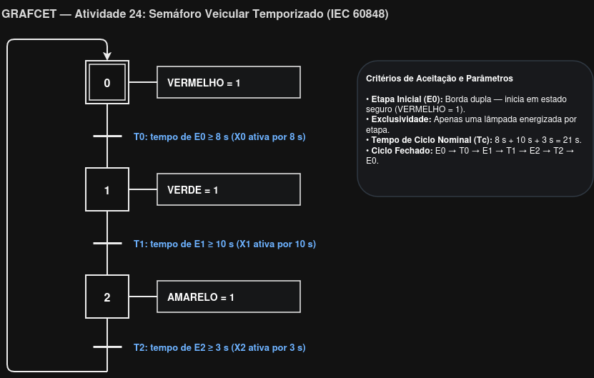

# UC Sistemas Automatizados — Semana 05: Sistemas Sequenciais e GRAFCET/SFC

Repositório da entrega obrigatória da **Semana 05 (TP05 — Atividade 24: Semáforo Veicular Temporizado)** da Unidade Curricular de **Sistemas Automatizados** (Engenharia de Software — USJT, Prof. Calvetti).

---

## 🎯 1. Objetivo e Artefatos Entregues

Modelar, documentar e validar por percurso manual o comportamento sequencial cíclico de um semáforo veicular utilizando a notação **GRAFCET (IEC 60848)** no **diagrams.net**.

* **Arquivo-fonte editável (`.drawio`):** [`./grafcet.drawio`](./grafcet.drawio)
* **Evidência visual exportada (`.png`):** [`./grafcet.png`](./grafcet.png)
* **Tabela auditável de cenários (`.csv`):** [`./casos_teste.csv`](./casos_teste.csv)
* **Notas sobre limites e melhorias:** [`./NOTAS.md`](./NOTAS.md)

---

## 📐 2. Convenções, Hipóteses e Critérios de Segurança

1. **Etapa Inicial Inequívoca (`E0`):** Representada por quadrado duplo (`X0 = 1` na inicialização). O sistema inicia obrigatoriamente em **`VERMELHO = 1`**, assegurando que o tráfego permaneça retido até que o ciclo completo seja estabelecido.
2. **Exclusividade das Ações:** Cada etapa energiza exatamente uma saída luminosa (`VERMELHO`, `VERDE` ou `AMARELO`), mantendo as demais em `0` enquanto a etapa estiver ativa.
3. **Origem e Unidade das Temporizações:** Os temporizadores iniciam a contagem no exato instante em que a respectiva etapa é ativada, com unidade expressa em segundos (`s`).
4. **Tempo Nominal de Ciclo ($T_c$):**
   $$T_c = t_{E0} + t_{E1} + t_{E2} = 8\text{ s} + 10\text{ s} + 3\text{ s} = 21\text{ s}$$
   Capacidade teórica nominal: $\frac{3600\text{ s}}{21\text{ s}} \approx 171,4\text{ ciclos/hora}$.

---

## 🔄 3. Especificação Estrutural do GRAFCET

### 3.1. Tabela de Etapas e Ações
| Etapa | Tipo | Situação Operacional | Ação Associada (`= 1`) | Saídas Inativas (`= 0`) |
| :---: | :--- | :--- | :--- | :--- |
| **`E0`** | Inicial (borda dupla) | Sinal fechado (retenção) | `VERMELHO = 1` | `VERDE = 0`, `AMARELO = 0` |
| **`E1`** | Normal | Sinal aberto (circulação) | `VERDE = 1` | `VERMELHO = 0`, `AMARELO = 0` |
| **`E2`** | Normal | Atenção / transição para parada | `AMARELO = 1` | `VERMELHO = 0`, `VERDE = 0` |

### 3.2. Tabela de Transições e Receptividades
| Transição | Evolução (`De → Para`) | Receptividade | Condição de Disparo |
| :---: | :---: | :--- | :--- |
| **`T0`** | `E0 → E1` | `tempo de E0 ≥ 8 s` (`X0 ativa por 8 s`) | `E0` ativa e temporizador atingir `8,0 s` |
| **`T1`** | `E1 → E2` | `tempo de E1 ≥ 10 s` (`X1 ativa por 10 s`) | `E1` ativa e temporizador atingir `10,0 s` |
| **`T2`** | `E2 → E0` | `tempo de E2 ≥ 3 s` (`X2 ativa por 3 s`) | `E2` ativa e temporizador atingir `3,0 s` (fecha o ciclo) |

---

## 🖼️ 4. Diagrama GRAFCET (Evidência Visual)

---

## 🧪 5. Percurso Manual e Tabela de Cenários de Teste

Validação cobrindo inicialização segura, fronteiras temporais (imediatamente antes e no instante exato de disparo) e condição de falha:

| ID | Cenário Testado | Etapa Atual | Tempo / Evento Aplicado | Transição | Próxima Etapa | `VERMELHO` | `VERDE` | `AMARELO` | Situação |
| :---: | :--- | :---: | :--- | :---: | :---: | :---: | :---: | :---: | :---: |
| **`F01`** | Inicialização segura | — | `t = 0,0 s` (Power-on / Reset) | Inicial | **`E0`** | `1` | `0` | `0` | PASSA |
| **`S01`** | Fronteira antes de `T0` | `E0` | `7,9 s` (`< 8,0 s`) | Nenhuma | **`E0`** | `1` | `0` | `0` | PASSA |
| **`S02`** | Limite exato de `T0` | `E0` | `8,0 s` (`≥ 8,0 s`) | `T0` | **`E1`** | `0` | `1` | `0` | PASSA |
| **`S03`** | Fronteira antes de `T1` | `E1` | `9,9 s` (`< 10,0 s`) | Nenhuma | **`E1`** | `0` | `1` | `0` | PASSA |
| **`S04`** | Limite exato de `T1` | `E1` | `10,0 s` (`≥ 10,0 s`) | `T1` | **`E2`** | `0` | `0` | `1` | PASSA |
| **`S05`** | Fronteira antes de `T2` | `E2` | `2,9 s` (`< 3,0 s`) | Nenhuma | **`E2`** | `0` | `0` | `1` | PASSA |
| **`S06`** | Limite exato de `T2` | `E2` | `3,0 s` (`≥ 3,0 s`) | `T2` | **`E0`** | `1` | `0` | `0` | PASSA |
| **`F02`** | Falha de timer em `E1` | `E1` | Timer travado em `t < 10,0 s` | Nenhuma | **`E1`** | `0` | `1` | `0` | PASSA |

---

## 📚 6. Referências
* IEC. *IEC 60848:2013 — GRAFCET specification language for sequential function charts*.
* IEC. *IEC 61131-3:2025 — Programmable controllers — Part 3: Programming languages*.
* LAMB, F. *Industrial Automation: Hands-On*. McGraw-Hill, 2013.
* PRUDENTE, F. *Automação Industrial — PLC: Programação e Aplicações*. Rio de Janeiro: LTC.
