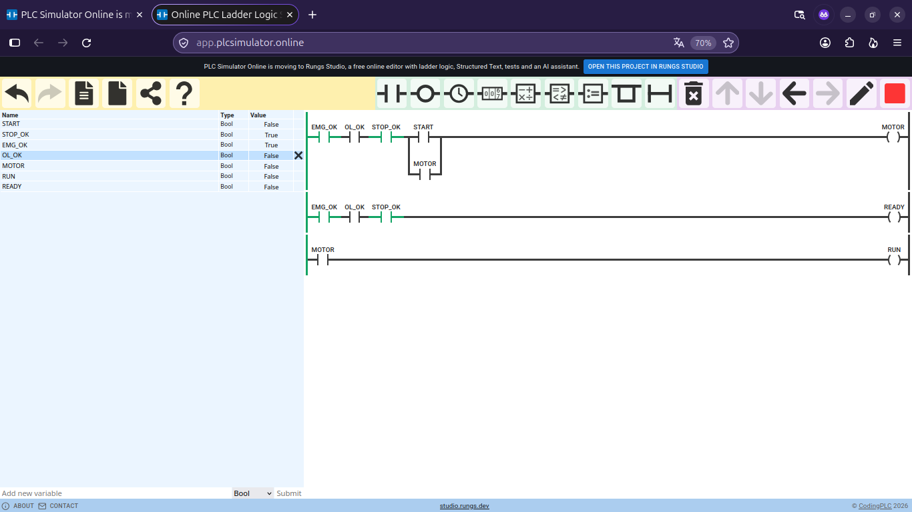

# UC Sistemas Automatizados — Semana 06: CLP e Linguagem Ladder

---

## 🔗 1. Link da Simulação Executável

* **Programa Ladder (PLC Simulator Online):** [Acessar Simulação no PLC Simulator Online](https://app.plcsimulator.online/lTdeTHANU9ZFeMeqxY8W)
* **Tabela de Testes Auditável (`.csv`):** [`./casos_teste.csv`](./casos_teste.csv)

---

## 🏷️ 2. Tabela de Entradas e Saídas (Tags)

Adota-se **lógica positiva** onde `1` (`True`) representa condição ativa ou permissivo saudável:

| Tag | Tipo | Papel | Convenção Lógica (`1` = TRUE) | Convenção Lógica (`0` = FALSE) |
| :--- | :--- | :--- | :--- | :--- |
| **`START`** | Entrada | Comando de partida | Botão de partida pressionado (pulso) | Botão de partida liberado |
| **`STOP_OK`** | Entrada | Parada prioritária | Cadeia de parada saudável (normal) | Comando de parada acionado |
| **`EMG_OK`** | Entrada | Permissivo de emergência | Emergência liberada (normal) | Emergência acionada |
| **`OL_OK`** | Entrada | Permissivo de sobrecarga | Relé térmico saudável (sem falha) | Sobrecarga detectada (desarme) |
| **`MOTOR`** | Saída | Comando do contator | Motor comandado / energizado | Motor desenergizado |
| **`RUN`** | Saída | Sinalização de operação | Indica `MOTOR = 1` comandado | Indica `MOTOR = 0` |
| **`READY`** | Saída | Sinalização de disponibilidade | Todos os permissivos saudáveis (`1`) | Algum permissivo impedindo partida |

---

## 🧮 3. Equações Booleanas e Estrutura Ladder

1. **Partida com Selo e Parada Prioritária:**
   $$\text{MOTOR}_{\text{próximo}} = \text{EMG\_OK} \cdot \text{OL\_OK} \cdot \text{STOP\_OK} \cdot (\text{START} + \text{MOTOR}_{\text{atual}})$$
   *Justificativa:* Os contatos `EMG_OK`, `OL_OK` e `STOP_OK` ficam em série **antes** da derivação paralela de `START` e `MOTOR`, garantindo que qualquer parada ou falha interrompa simultaneamente o botão de partida e o ramo de retenção (selo).

2. **Sinalizações de Disponibilidade (`READY`) e Comando (`RUN`):**
   $$\text{READY} = \text{EMG\_OK} \cdot \text{OL\_OK} \cdot \text{STOP\_OK}$$
   $$\text{RUN} = \text{MOTOR}$$

3. **Diagrama Ladder Implementado:**

    Rung 1 (Partida com Selo e Permissivos Prioritários):
    |---[ EMG_OK ]---[ OL_OK ]---[ STOP_OK ]---+---[ START ]---+---( MOTOR )---|
    |                                          +---[ MOTOR ]---+

    Rung 2 (Indicação de Prontidão / Permissivos Saudáveis):
    |---[ EMG_OK ]---[ OL_OK ]---[ STOP_OK ]-----------------------( READY )---|

    Rung 3 (Indicação de Estado Comandado):
    |---[ MOTOR ]--------------------------------------------------(  RUN  )---|

---

## 🧪 4. Tabelas de Testes e Resultados Obtidos

### 4.1. Tabela de Testes Obrigatória (`T01` a `T05`)
| ID | Condição Inicial | Ação / Evento | `MOTOR` Esperado | `MOTOR` Obtido | Situação | Justificativa |
| :---: | :--- | :--- | :---: | :---: | :---: | :--- |
| **`T01`** | Permissivos `= 1`, `M = 0` | Pressionar `START = 1` | `1` | `1` | PASSA | Caminho de partida completo energiza `MOTOR` |
| **`T02`** | Permissivos `= 1`, `M = 1` | Soltar `START = 0` | `1` | `1` | PASSA | Contato auxiliar `MOTOR` mantém o selo |
| **`T03`** | `M = 1`, `EMG_OK = 1`, `OL_OK = 1` | Acionar `STOP_OK = 0` | `0` | `0` | PASSA | Parada abre em série antes do ramo de selo |
| **`T04`** | `M = 1`, `STOP_OK = 1`, `OL_OK = 1` | Acionar `EMG_OK = 0` | `0` | `0` | PASSA | Emergência remove continuidade do rung |
| **`T05`** | `M = 0`, `EMG_OK = 0` | Pressionar `START = 1` | `0` | `0` | PASSA | Comando `START` não vence permissivo aberto |

### 4.2. Testes de Falha e Retomada Controlada (`F01` a `F05`)
| ID | Preparação | Ação / Evento | `MOTOR` Esperado | `MOTOR` Obtido | Situação | Comportamento Observado |
| :---: | :--- | :--- | :---: | :---: | :---: | :--- |
| **`F01`** | `MOTOR = 1`, permissivos `= 1` | Simular sobrecarga (`OL_OK = 0`) | `0` | `0` | PASSA | Falha térmica derruba imediatamente `MOTOR` e `READY` |
| **`F02`** | `OL_OK = 0`, `MOTOR = 0` | Pressionar `START = 1` | `0` | `0` | PASSA | Partida bloqueada enquanto sobrecarga persistir |
| **`F03`** | Falha removida, `START = 0` | Restaurar `OL_OK = 1` sem `START` | `0` | `0` | PASSA | Sem religamento automático (o selo foi desfeito) |
| **`F04`** | Permissivos `= 1`, `MOTOR = 0` | Novo pulso `START = 1` | `1` | `1` | PASSA | Retomada ocorre somente após novo comando de partida |
| **`F05`** | `MOTOR = 1`, permissivos `= 1` | Acionar emergência (`EMG_OK = 0`) | `0` | `0` | PASSA | Parada imediata com prioridade sobre o selo |

---

## 🖼️ 5. Evidências Visuais (Capturas de Tela)

* **1. Partida Válida (`T01` — `START=1` com permissivos saudáveis):**
  

* **2. Retenção por Selo (`T02` — `START=0` e `MOTOR=1` mantido):**
  

* **3. Parada / Emergência Prioritária (`T03`/`T04` — `STOP_OK=0` ou `EMG_OK=0` derrubando o selo):**
  

* **4. Falha e Retomada Controlada (`F01`/`F03` — `OL_OK=0` e ausência de religamento automático):**
  

---

## ⚠️ 6. Diagnóstico de Mutação e Limites da Simulação

1. **Risco de Mutação no Selo (`STOP_OK` dentro do ramo):** Caso `STOP_OK` fosse inserido apenas em série com `START` (e não antes da derivação paralela), o contato de selo `MOTOR` contornaria o botão de parada, mantendo o motor energizado e ignorando o comando de desligamento.
2. **Impacto do Ciclo de Varredura (*Scan Time*):** O CLP lê todas as entradas para a imagem de processo no início da varredura, executa os rungs sequencialmente e atualiza as saídas físicas ao final. Uma mudança em `START` ocorrida após a fase de leitura só será reconhecida na varredura seguinte.
3. **Limites de Segurança Funcional:** A sinalização `RUN` comprova apenas o estado lógico comandado na memória do CLP (não confirma rotação mecânica ou fechamento físico do contator). Além disso, a simulação em Ladder demonstra a prioridade lógica, mas não substitui relés/CLPs de segurança certificados, contatos positivamente guiados e análise de risco conforme a IEC 61131-3 e ISO 12100.

---

## 📚 7. Referências
* IEC. *IEC 61131-3:2025 — Programmable controllers — Part 3: Programming languages*.
* LAMB, F. *Automação industrial na prática*. Porto Alegre: AMGH, 2015.
* PRUDENTE, F. *Automação industrial: PLC, programação e aplicações*. Rio de Janeiro: LTC.
* PLC SIMULATOR ONLINE. *Documentation*. Disponível em: [https://plcsimulator.online/docs](https://plcsimulator.online/docs).
