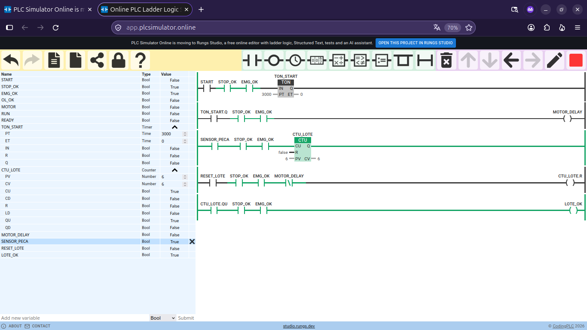

# UC Sistemas Automatizados — Semana 07: Programação Sequencial de CLP

---

## 🔗 1. Links e Artefatos Entregues

* **Programa Ladder Executável (PLC Simulator Online):** [Acessar Projeto no PLC Simulator Online](https://app.plcsimulator.online/1qNLllgVXBDudVHQjGqR)
* **Tabela Auditável de Cenários (`.csv`):** [`./casos_teste.csv`](./casos_teste.csv)

---

## 🏷️ 2. Tags, Parâmetros e Convenções Lógicas

Adota-se **lógica positiva** (`1` = condição ativa ou permissivo saudável com sufixo `_OK`):

| Tag / Bloco | Tipo | Valor Inicial | Parâmetro / Papel Operacional |
| :--- | :--- | :---: | :--- |
| **`START`** | `BOOL` (Entrada) | `0` | Comando de partida temporizada |
| **`STOP_OK`** | `BOOL` (Entrada) | `1` | Permissivo de parada (`0` interrompe temporização e saídas) |
| **`EMG_OK`** | `BOOL` (Entrada) | `1` | Permissivo de emergência (`0` remove movimentos imediatamente) |
| **`SENSOR_PECA`** | `BOOL` (Entrada) | `0` | Sensor óptico/indutivo de passagem de peça na esteira |
| **`RESET_LOTE`** | `BOOL` (Entrada) | `0` | Comando de zeragem do contador de lote |
| **`TON_START`** | `TON` (Timer) | `PT = 3 s` (`3000 ms`) | Temporizador com atraso na energização para partida |
| **`CTU_LOTE`** | `CTU` (Contador) | `PV = 6` | Contador crescente de peças concluídas no lote |
| **`MOTOR_DELAY`** | `BOOL` (Saída) | `0` | Saída acionada 3 s após `START` com permissivos saudáveis |
| **`LOTE_OK`** | `BOOL` (Saída) | `0` | Sinalização de lote completo (`CV >= 6`) |

---

## ⚙️ 3. Lógica Implementada e Regras de Prioridade

1. **Atraso na Energização (`TON_START` e `MOTOR_DELAY`):**
   * Habilitação: $\text{TON\_START.IN} = \text{START} \cdot \text{STOP\_OK} \cdot \text{EMG\_OK}$ com $\text{PT} = 3\text{ s}$.
   * Atuação: $\text{MOTOR\_DELAY} = \text{TON\_START.Q} \cdot \text{STOP\_OK} \cdot \text{EMG\_OK}$.
   * *Comportamento:* Se `START`, `STOP_OK` ou `EMG_OK` cair para `0` antes ou depois de `3 s`, `ET` e `Q` retornam a `0` imediatamente.
2. **Contagem por Evento (Borda de Subida) vs. Nível:**
   * Como um sensor físico permanece em `1` durante várias varreduras do CLP, a entrada do `CTU_LOTE` reage apenas à transição $0 \rightarrow 1$ ($\text{PULSO} = \text{SENSOR\_PECA} \cdot \neg \text{SENSOR\_ANT}$), garantindo exatamente $1$ incremento por peça.
3. **Reset Controlado com Prioridade:**
   * Condição de zeragem: $\text{RESET\_PERMITIDO} = \text{RESET\_LOTE} \cdot \text{STOP\_OK} \cdot \text{EMG\_OK} \cdot \neg \text{MOTOR\_DELAY}$.
   * O reset domina a contagem simultânea e só é aceito com a máquina parada e permissivos saudáveis.

---

## 🧪 4. Tabela de Casos de Teste e Resultados

| ID | Condição Inicial | Estímulo / Evento | Resultado Esperado | Resultado Obtido | Situação |
| :---: | :--- | :--- | :--- | :--- | :---: |
| **`T01`** | `TON` inativo (`START=0`) | Acionar `START=1` por `2,0 s` (`< 3 s`) | `ET < PT`, `Q=0`, `MOTOR_DELAY=0` | `MOTOR_DELAY=0` | PASSA |
| **`T02`** | `TON` inativo, permissivos `= 1` | Manter `START=1` por `3,0 s` (`>= 3 s`) | `ET >= PT`, `Q=1`, `MOTOR_DELAY=1` | `MOTOR_DELAY=1` | PASSA |
| **`T03`** | `TON` contando (`ET = 1,5 s`) | Acionar `STOP_OK=0` durante contagem | `ET` zera, `Q=0`, `MOTOR_DELAY=0` | `MOTOR_DELAY=0` | PASSA |
| **`T04`** | `MOTOR_DELAY=1` (`Q=1`) | Acionar emergência `EMG_OK=0` | `ET` zera, `Q=0`, `MOTOR_DELAY=0` | `MOTOR_DELAY=0` | PASSA |
| **`T05`** | Falha liberada, `START=0` | Restaurar `EMG_OK=1` sem `START` | `MOTOR_DELAY` permanece `0` | `MOTOR_DELAY=0` | PASSA |
| **`C01`** | `CV = 0`, permissivos `= 1` | Borda `0->1` em `SENSOR_PECA` mantida | `CV = 1` (sem repetir por varredura) | `CV = 1` | PASSA |
| **`C02`** | `CV = 5`, permissivos `= 1` | 6ª borda em `SENSOR_PECA` | `CV = 6`, `LOTE_OK = 1` | `CV = 6`, `LOTE_OK = 1` | PASSA |
| **`R01`** | `CV = 6`, `MOTOR_DELAY=0` | Acionar `RESET_LOTE=1` | `CV = 0`, `LOTE_OK = 0` | `CV = 0`, `LOTE_OK = 0` | PASSA |
| **`R02`** | `CV = 6`, `MOTOR_DELAY=1` | Acionar `RESET_LOTE=1` em operação | `CV` mantém `6` (reset bloqueado) | `CV = 6` | PASSA |

---

## 🖼️ 5. Evidências Visuais (Capturas de Tela)

* **1. Temporizador `TON` em Progresso (`T01` — `ET < 3 s` e `MOTOR_DELAY = 0`):**
  

* **2. Temporizador `TON` Concluído (`T02` — `ET >= 3 s` e `MOTOR_DELAY = 1`):**
  

* **3. Contagem de Lote Completo (`C02` — `CV = 6` e `LOTE_OK = 1`):**
  

* **4. Reset Controlado e Emergência (`R01`/`T04` — `CV = 0` e bloqueio seguro):**
  

---

## ⚠️ 6. Conversão GRAFCET $\rightarrow$ Ladder e Limites da Simulação

1. **Mapeamento Sequencial (IEC 60848 $\rightarrow$ IEC 61131-3):** Em aplicações com múltiplas etapas (como `E0` Transportar, `E1` Encher e `E2` Liberar), cada etapa corresponde a um bit de memória exclusivo (`SET` na etapa seguinte e `RESET` simultâneo na anterior), enquanto as ações (`M_EST`, `Y_VALV`) são condicionadas ao bit da etapa ativa e aos permissivos de segurança (`STOP_OK`, `EMG_OK`).
2. **Limites do Ambiente Simulado:** A precisão temporal de `TON` e a detecção de bordas dependem do ciclo de varredura (*scan time*) do navegador. Além disso, a remoção lógica de saídas por `EMG_OK = 0` comprova apenas o comportamento funcional do programa, não substituindo relés/CLPs de segurança certificados ou análise de risco conforme a ISO 12100.

---

## 📚 7. Referências
* IEC. *IEC 61131-3:2025 — Programmable controllers — Part 3: Programming languages*.
* IEC. *IEC 60848:2013 — GRAFCET specification language for sequential function charts*.
* PETRUZELLA, F. D. *Programmable Logic Controllers*. McGraw-Hill.
* PLC SIMULATOR ONLINE. *Documentation: timers, counters and Ladder elements*. Disponível em: [https://plcsimulator.online/docs/](https://plcsimulator.online/docs/).
