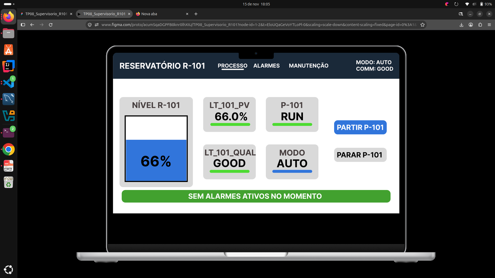
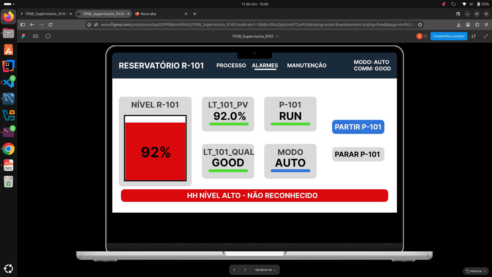
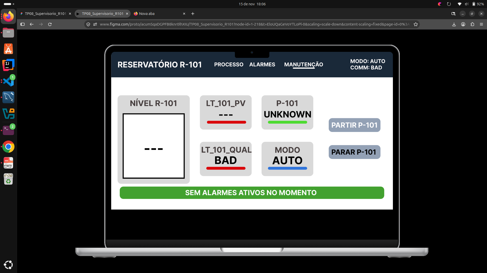

# UC Sistemas Automatizados — Semana 08: Sistemas Supervisórios (HMI R-101)

---

## 🔗 1. Link do Protótipo e Artefatos

* **Protótipo Navegável (Figma — Modo Present):** [Abrir Protótipo no Figma](https://www.figma.com/proto/acumSqaDGPFB8knr0lhXIU/TP08_Supervisorio_R101?node-id=1-218&t=MwrQRQ8BHQ10YOGP-1&scaling=scale-down&content-scaling=fixed&page-id=0%3A1&starting-point-node-id=1%3A2)
* **Backup do Link:** [`./prototipo/link-figma.txt`](./prototipo/link-figma.txt)
* **Dicionário de Tags (`.csv`):** [`./testes/tags.csv`](./testes/tags.csv)
* **Casos de Teste Executados (`.csv`):** [`./testes/casos_teste.csv`](./testes/casos_teste.csv)

---

## 🎯 2. Escopo do Processo e Arquitetura de Telas

O supervisório modela a operação do **Reservatório R-101**, equipado com transmissor de nível `LT-101` (`0` a `100%`), bomba de alimentação `P-101` e bomba de drenagem `P-102`, operando sob modos `LOCAL/REMOTO` e `MANUAL/AUTO`.

### Mapa de Navegação (Bidirecional)
```text
[ Processo (Visão Geral) ] <---> [ Alarmes (Lista & Reconhecimento) ]
           ^
           |
           v
[ Manutenção (Diagnóstico & Matriz de Permissivos) ]
```

1. **Tela `Processo`:** Exibe nível gráfico e numérico (`LT_101_PV` + `%`), qualidade (`GOOD`/`BAD`), estado real (`RUN`/`STOP`/`UNKNOWN`), modo (`AUTO`/`MANUAL`, `REMOTO`/`LOCAL`), banner de alarme mais crítico, botões de comando com modal de confirmação específica para `Parar P-101` e controles de demonstração de cenários (`Normal 66%`, `Alarme HH 92%` e `Falha COMM_PLC=0`).
2. **Tela `Alarmes`:** Lista cronológica com colunas *Data/Hora, Prioridade, Fonte, Mensagem, Estado (`Ativo Não Reconhecido`, `Reconhecido`, `Normalizado`) e Ação Recomendada*, contendo os alarmes `A01` a `A04`.
3. **Tela `Manutenção`:** Apresenta estado de comunicação (`COMM_PLC`), timestamp de atualização, matriz auditável de permissivos da `P-101` (`COMM_PLC=GOOD`, `MODO=REMOTO`, `NIVEL_OK=1`, `EMG_OK=1`, `P101_FAIL=0`), histórico de último comando vs. retorno e restrição por perfil de acesso.

---

## 🚨 3. Matriz de Alarmes e Regras de Apresentação

| ID | Tag / Condição | Prioridade | Mensagem na HMI | Ação Recomendada ao Operador |
| :---: | :--- | :---: | :--- | :--- |
| **`A01`** | `LT_101_PV >= 75%` (`ALM_H`) | Média | `R-101 Nível Alto (H) — Atenção` | Verificar vazão de entrada/saída e acompanhar tendência |
| **`A02`** | `LT_101_PV >= 90%` (`ALM_HH`) | Alta | `R-101 HH Nível Alto — Não Reconhecido` | Interromper enchimento (`P-101`) e drenar se permitido |
| **`A03`** | `P101_FAIL = 1` | Alta | `Falha ativa na bomba P-101` | Parar sequência automática e acionar equipe de manutenção |
| **`A04`** | `COMM_PLC = 0` (`BAD`) | Alta | `Falha de comunicação — comandos bloqueados` | Validar enlace de rede/CLP; não confiar em leituras antigas |

---

## 🧪 4. Casos de Teste Executados (`T01` a `T05` e `P01`)

| ID | Cenário | Estímulo / Ação | Resultado Esperado | Resultado Obtido | Situação |
| :---: | :--- | :--- | :--- | :--- | :---: |
| **`T01`** | Condição normal | `PV = 66%`, `QUAL = GOOD`, `COMM_PLC = 1` | Normal; `P-101 RUN`; comandos disponíveis | `66% GOOD`, comandos ativos | PASSA |
| **`T02`** | Atenção nível H | `PV = 78%` (`>= 75%`), `QUAL = GOOD` | Alarme `A01` (Média) visível com orientação | `A01` exibido na lista e resumo | PASSA |
| **`T03`** | Alarme crítico HH | `PV = 92%` (`>= 90%`), `QUAL = GOOD` | `A02` (Alta) destacado com cor + texto + ícone | `A02` ativo sem ocultar `92%` | PASSA |
| **`T04`** | Falha de comunicação | `COMM_PLC = 0` (`QUAL = BAD`) | `PV` substituído por `---`, `UNKNOWN`, comandos bloqueados | `---` exibido e botões bloqueados | PASSA |
| **`T05`** | Parar `P-101` | Clicar em `Parar P-101` | Modal específico; separa `CMD` enviado de `RUN = 0` | Confirmação e retorno separados | PASSA |
| **`P01`** | Navegação bidirecional | Percorrer `Processo`, `Alarmes` e `Manutenção` | Ida e retorno em 1 clique sem telas presas | Navegação completa em `Present` | PASSA |

---

## 🖼️ 5. Evidências Visuais (Capturas do Protótipo)

* **1. Tela Processo — Condição Normal (`PV = 66%`, `GOOD`, `P-101 RUN`):**
  

* **2. Tela Processo — Alarme Crítico HH (`PV = 92%`, `A02 Não Reconhecido`):**
  

* **3. Tela Processo — Falha de Comunicação (`COMM_PLC = BAD`, `---`, `UNKNOWN` e bloqueio):**
  

---

## ⚠️ 6. Decisões de Projeto e Limites do Protótipo

1. **Separação entre Controle e Supervisão:** Intertravamentos críticos (como parada automática da bomba ao atingir nível `>= 90%`) residem determinísticamente no CLP; a HMI apenas apresenta estados, registra eventos e envia solicitações sujeitas à validação de permissivos.
2. **Distinção entre Comando (`CMD`) e Estado (`RUN`):** Acionar um botão na HMI gera apenas uma solicitação (`P101_CMD`); a interface aguarda o retorno real do processo (`P101_RUN`) para confirmar a mudança, evitando "comandos fantasmas".
3. **Redundância Visual e Qualidade de Dado:** Nenhum estado depende exclusivamente de cor (sempre acompanhado de texto e rótulo). Sob `COMM_PLC = BAD`, valores numéricos são ocultados (`---`) para impedir decisões baseadas em dados desatualizados.
4. **Limites da Simulação:** O protótipo no Figma valida ergonomia, hierarquia visual, matriz de alarmes e fluxos de navegação, não executando comunicação industrial real (OPC UA / Modbus) nem armazenamento histórico em banco de dados SCADA.

---

## 📚 7. Referências
* ISA. *ISA-101.01: Human Machine Interfaces for Process Automation Systems*.
* ISA. *ISA-18.2: Management of Alarm Systems for the Process Industries*.
* IEC. *IEC 62443: Industrial communication networks — Network and system security*.
* FIGMA. *Prototyping and sharing documentation*. Disponível em: [https://help.figma.com/](https://help.figma.com/).
