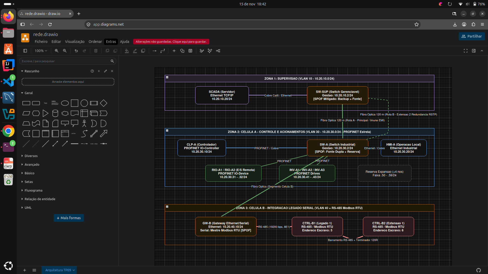
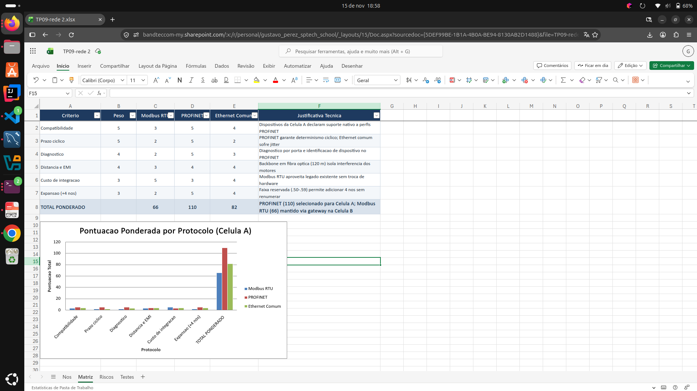

# UC Sistemas Automatizados — Semana 09: Redes Industriais

---

## 🔗 1. Artefatos Entregues

* **Diagrama Editável (`diagrams.net`):** [`./diagrama/rede.drawio`](./diagrama/rede.drawio)
* **Diagrama Exportado em PDF:** [`./diagrama/rede.pdf`](./diagrama/rede.pdf)
* **Planilha Completa (`Nós`, `Matriz`, `Riscos`, `Testes`):** [`./planilha/TP09-rede.xlsx`](./planilha/TP09-rede.xlsx)
* **Tabela Auditável de Casos de Teste (`.csv`):** [`./testes/casos_teste.csv`](./testes/casos_teste.csv)

---

## 🏭 2. Cenário, Requisitos Dominantes e Segmentação por Zonas

O projeto atende uma planta industrial dividida em **três zonas funcionais**[cite: 196, 198]:

1. **Supervisão (`10.20.10.0/24` — VLAN 10):** Servidor `SCADA` localizado na sala de controle a **120 m** das células de produção, conectado via switch gerenciável `SW-SUP`[cite: 196, 197].
2. **Célula A (`10.20.30.0/24` — VLAN 30):** Topologia em **estrela** centrada no switch industrial `SW-A`, interligando `CLP-A`, `HMI-A`, duas remotas de E/S (`RIO-A1`, `RIO-A2`) e três inversores de frequência (`INV-A1` a `INV-A3`), com reserva para **4 novos nós** e tempo máximo de recuperação aceitável de **15 minutos**[cite: 196, 197].
3. **Célula B (`10.20.40.0/24` + Barramento Serial RS-485):** Integração de controladores legados (`CTRL-B1` e `CTRL-B2`) via gateway Ethernet/Modbus RTU (`GW-B`), preservando os ativos legados sem estender o barramento serial até a rede de supervisão[cite: 196, 197, 199].

### Justificativa Técnica de Topologias, Meios e Protocolos
* **Célula A (`PROFINET` sobre Ethernet Industrial em Estrela):** Escolhido por atender ao requisito dominante de atualização cíclica determinística de E/S e acionamentos, oferecer diagnóstico por porta e suportar perfis padronizados (GSDML)[cite: 195, 196, 197, 199]. A topologia em estrela isola falhas por enlace individual[cite: 194, 199].
* **Backbone entre Áreas (`Fibra Óptica` — 120 m):** Adotada entre `SW-SUP`, `SW-A` e `GW-B` devido à distância de 120 m (acima do limite recomendado para par trançado em ambiente ruidoso) e à imunidade total contra interferência eletromagnética (EMI) gerada pelos inversores e motores[cite: 195, 196, 199].
* **Célula B (`Modbus RTU` sobre RS-485):** Mantido no trecho de campo legado conectado ao `GW-B`, com parâmetros seriais padronizados (`19200 bps, 8E1`), terminação de $120\,\Omega$ e tratamento explícito de *timeout*[cite: 199, 248].

---

## 🗺️ 3. Mapa Completo de Endereçamento e Reservas

| Ativo | Zona | Interface / Protocolo | Endereço | Faixa Reservada | Criticidade |
| :--- | :--- | :--- | :--- | :--- | :---: |
| **`SW-SUP`** | Supervisão | Ethernet Gestão | `10.20.10.2/24` | `.1 – .9` (Infraestrutura) | Alta |
| **`SCADA`** | Supervisão | Ethernet TCP/IP | `10.20.10.20/24` | `.20 – .29` (Servidores) | Média |
| **`SW-A`** | Célula A | Ethernet Gestão | `10.20.30.2/24` | `.1 – .9` (Infraestrutura) | Alta |
| **`CLP-A`** | Célula A | PROFINET IO-Controller | `10.20.30.10/24` | `.10 – .19` (Controle) | Alta |
| **`HMI-A`** | Célula A | Ethernet Industrial | `10.20.30.20/24` | `.20 – .29` (Operação) | Média |
| **`RIO-A1 / A2`** | Célula A | PROFINET IO-Device | `10.20.30.31 – .32/24` | `.30 – .39` (E/S Remota) | Alta |
| **`INV-A1 a A3`** | Célula A | PROFINET Drive | `10.20.30.41 – .43/24` | `.40 – .49` (Acionamentos) | Alta |
| *Reserva Expansão* | Célula A | PROFINET / Ethernet | `10.20.30.51 – .54/24` | `.50 – .59` (+4 novos nós) | — |
| **`GW-B`** | Célula B | Ethernet / Mestre RTU | `10.20.40.10/24` | `.10 – .19` (Controle/GW) | Alta |
| **`CTRL-B1`** | Célula B | RS-485 / Modbus RTU | `Slave ID 5` | `1 – 9` (Escravos seriais) | Alta |
| **`CTRL-B2` (Ext. 1)** | Célula B | RS-485 / Modbus RTU | `Slave ID 6` | `1 – 9` (Escravos seriais) | Média |

---

## 📊 4. Matriz Ponderada de Seleção de Protocolo (Célula A)

| Critério | Peso | Modbus RTU | PROFINET | Ethernet Comum | Justificativa da Pontuação |
| :--- | :---: | :---: | :---: | :---: | :--- |
| **Compatibilidade** | 5 | 3 | **5** | 4 | Dispositivos da Célula A possuem perfil PROFINET nativo |
| **Prazo cíclico** | 5 | 2 | **5** | 2 | PROFINET assegura determinismo; Ethernet comum sofre *jitter* |
| **Diagnóstico** | 4 | 2 | **5** | 3 | PROFINET oferece diagnóstico por porta e topologia |
| **Distância e EMI** | 4 | 3 | **4** | 4 | Backbone em fibra óptica isola ruído dos motores |
| **Custo de integração** | 3 | **5** | 3 | 4 | Modbus RTU reaproveita legado sem troca de hardware |
| **Expansão (+4 nós)** | 3 | 2 | **5** | 4 | Endereçamento IP segmentado facilita expansão |
| **TOTAL PONDERADO** | — | **66** | **110** | **82** | **PROFINET selecionado** para Célula A; Modbus RTU mantido na Célula B |

---

## ⚠️ 5. Pontos Únicos de Falha (SPOF) e Mitigações

| Elemento | Falha Simulada | Impacto | Mitigação Aplicada | Teste de Validação |
| :--- | :--- | :--- | :--- | :--- |
| **`SW-A`** | Falta de energia 24 V | Isolamento total da Célula A | Fonte 24 V redundante, backup versionado e switch reserva | Desligar fonte primária e medir tempo de retorno ($\le 15\text{ min}$) |
| **`GW-B`** | Travamento do gateway | Perda de dados de `CTRL-B1` e `CTRL-B2` | *Watchdog*, *timeout* de $500\text{ ms}$ e estado seguro no `CLP-A` | Desconectar `GW-B` e confirmar alarme no supervisório |
| **Fibra Óptica** | Rompimento do enlace | `SCADA` perde comunicação com células | Rota física redundante (Extensão 2) + autonomia local do `CLP-A` | Desconectar Rota A e validar comutação sem parar a célula |
| **Plano IP** | Endereço IP duplicado | Instabilidade e perda de pacotes | Alocação estática, reservas por função e fórmula `CONT.SE` | Inserir IP duplicado na planilha/bancada e validar alerta |

---

## 🚀 6. Extensões Implementadas (Extensões 1, 2 e 3)

### Extensão 1 — Integração de Segundo Equipamento Legado (`CTRL-B2`)
* **Endereçamento e Registradores:** Adicionado o escravo `CTRL-B2` no endereço Modbus RTU **`6`** no mesmo barramento RS-485 de `CTRL-B1` (`ID 5`), lendo registradores *Holding Registers* `40001–40004` (status e variáveis de processo) com *timeout* de `150 ms` e até `2` retentativas[cite: 201, 268].
* **Recálculo do Ciclo Serial:** Com 3 transações de consulta de `45 ms` + `20 ms` de intervalo cada (`65 ms/consulta`), o tempo base é $3 \times 65\text{ ms} = 195\text{ ms}$. Aplicando margem de segurança de $25\%$, obtém-se $195 \times 1,25 = 243,75\text{ ms}$, permanecendo bem abaixo do limite máximo de **`500 ms`** exigido pelo processo[cite: 201].

### Extensão 2 — Disponibilidade e Redundância de Backbone Óptico
* **Arquitetura Redundante:** Adicionada uma segunda ligação em fibra óptica (**Rota B**) entre `SW-SUP` e `SW-A` operando com protocolo **RSTP** (tempo de comutação $< 200\text{ ms}$), zerando o tempo de indisponibilidade do supervisório em caso de rompimento físico do cabo principal[cite: 201, 269].
* **Eliminação de Falha de Causa Comum:** A Rota B percorre eletroduto físico separado da Rota A e os switches são alimentados por fontes independentes, evitando que um único dano mecânico ou elétrico derrube ambos os caminhos simultaneamente[cite: 195, 201, 269].

### Extensão 3 — Auditoria de Revisão por Pares (Antes vs. Depois)

| Item Auditado | Problema Identificado na Revisão | Correção Aplicada | Artefato Alterado |
| :--- | :--- | :--- | :--- |
| **1. Controle de Duplicidade** | Atribuição manual de IPs poderia gerar conflito silencioso na Célula A | Inserida fórmula `=CONT.SE($E$2:$E$15;E2)>1` na aba `Nós` e faixas de reserva explícitas | `planilha/TP09-rede.xlsx` |
| **2. Pontos Únicos de Falha** | `SW-A` e `GW-B` não estavam sinalizados visualmente como críticos no diagrama | Adicionado destaque visual `[SPOF]` nos nós e documentada mitigação de fonte/reserva | `diagrama/rede.drawio` |
| **3. Compatibilidade de Perfil** | Pontuação alta em Ethernet comum não garante determinismo de I/O cíclico | Registrada restrição eliminatória de perfil GSDML/PROFINET antes da soma ponderada | `README.md` e `Matriz` |

---

## 🧪 7. Casos de Teste Executados (`T01` a `T07`)

| ID | Cenário | Estímulo / Ação | Resultado Esperado | Resultado Obtido | Situação |
| :---: | :--- | :--- | :--- | :--- | :---: |
| **`T01`** | Enlaces ativos | Verificar alcance de todos os nós | Todos os 13 ativos acessíveis e endereçados | Diagrama e inventário 100% alinhados | PASSA |
| **`T02`** | Falha de gateway | Desconectar `GW-B` | Apenas `CTRL-B1/B2` ficam offline; Célula A opera | Isolamento por zona confirmado | PASSA |
| **`T03`** | IP duplicado | Simular IP repetido na Célula A | Planilha acusa `DUPLICADO` e orienta correção | Fórmula e plano corrigem conflito | PASSA |
| **`T04`** | Falha de fibra | Romper Rota A até supervisão | Controle local ativo; Rota B assume supervisão | Autonomia e comutação validadas | PASSA |
| **`T05`** | Expansão futura | Incluir 4 nós na Célula A | Usam faixa `.51–.54` sem renumerar ativos | Reserva comporta expansão | PASSA |
| **`T06`** | 2º escravo RTU | Consultar `ID 5` e `ID 6` no RS-485 | Ciclo de `243,75 ms` (c/ margem) $< 500\text{ ms}$ | Prazo determinístico atendido | PASSA |
| **`T07`** | Revisão por pares | Auditar diagrama e planilha | 3 melhorias registradas e corrigidas | Tabela antes/depois concluída | PASSA |

---

## 🖼️ 8. Evidências Visuais

* **1. Arquitetura de Rede Industrial (3 Zonas, Fibra Principal/Redundante e RS-485):**
  

* **2. Planilha de Endereçamento e Matriz de Decisão:**
  

---

## ⚠️ 9. Limites da Validação Documental
Os artefatos produzidos no `diagrams.net` e na planilha `.xlsx` documentam a topologia, o endereçamento, os critérios de seleção e a análise de falhas, mas **não simulam tráfego em tempo real nem substituem medições em bancada física** (*jitter*, *scan time* real do CLP, perdas ópticas e certificação de segurança conforme IEC 62443)[cite: 200, 201, 203, 272].

---

## 📚 10. Referências
* IEC. *IEC 61158 / IEC 61784 — Industrial communication networks — Fieldbus specifications and profiles*[cite: 203].
* MODBUS ORGANIZATION. *Modbus Application Protocol Specification*[cite: 203].
* PI. *PROFIBUS and PROFINET Technology Descriptions and Guidelines*[cite: 203].
* NIST. *NIST SP 800-82 Rev. 3 — Guide to Operational Technology (OT) Security*[cite: 203].
